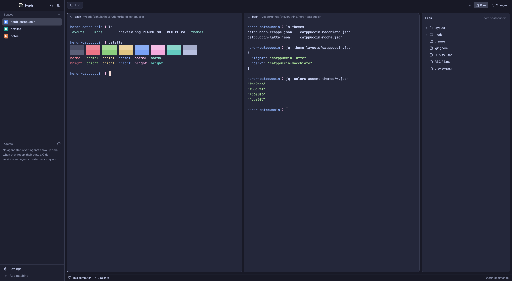
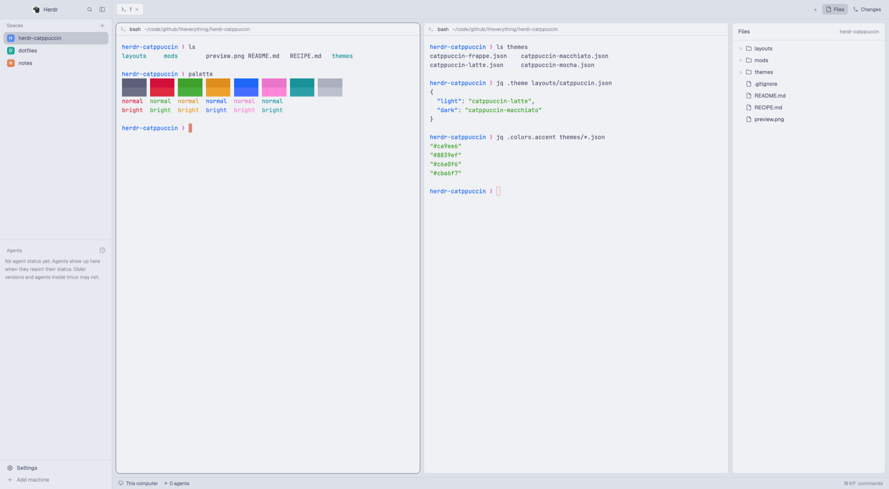
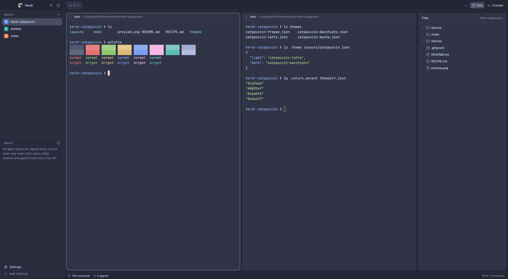
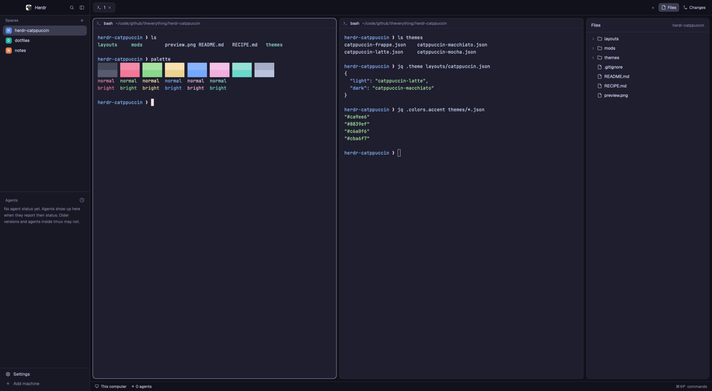

# Catppuccin for Herdr

[Catppuccin](https://catppuccin.com) for the [Herdr](https://herdr.dev) app, in
all four flavors: Latte, Frappé, Macchiato and Mocha. The colors are placed the
way the official [Catppuccin Zed port](https://github.com/catppuccin/zed) places
them: a Crust title bar and status bar, a Mantle sidebar, Base terminals, Mauve
accents and the official terminal palette of each flavor.



| Latte | Frappé |
|---|---|
|  |  |
| **Macchiato** | **Mocha** |
|  |  |

The layout follows your system: Latte in light mode, Macchiato in dark mode. To
use Frappé or Mocha in dark mode, pick it from the theme menu.

## Install

In Herdr, ask your agent:

> Add the Herdr layout at https://github.com/theverything/herdr-catppuccin

Or install it by hand:

```sh
git clone https://github.com/theverything/herdr-catppuccin
cd herdr-catppuccin
cp -Rn layouts themes mods ~/.config/herdr-app/
herdr-app do layout.switch --name catppuccin
```

`ctrl-shift-l` switches back to your other layouts. To remove it, delete
`layouts/catppuccin.*`, `themes/catppuccin-*.json` and `mods/catppuccin-*` from
`~/.config/herdr-app`.

### Just the colors

To keep your own layout, copy only `themes/catppuccin-*.json` into
`~/.config/herdr-app/themes/` and pick a flavor from the theme menu. You get the
palette, but the bars stay Mantle like the sidebar. The Crust bars need the
layout.

### Your terminal

To match your terminal emulator, use the official Catppuccin port for it, for
example [catppuccin/ghostty](https://github.com/catppuccin/ghostty). Other ports
are listed at [catppuccin.com/ports](https://catppuccin.com/ports).

## What's inside

| File | What it is |
|---|---|
| `layouts/catppuccin.json` | Herdr's `main` layout, using the mods below, with Latte for light mode and Macchiato for dark |
| `themes/catppuccin-latte.json` and the other flavors | each flavor's terminal and panel colors |
| `mods/catppuccin-tabs` | Herdr's tab bar, drawn in Crust, with the active tab in Base |
| `mods/catppuccin-chrome` | the sidebar's title row (Crust) and footer |
| `mods/catppuccin-status` | the status bar, drawn in Crust |
| `RECIPE.md` | how to rebuild it from scratch, with the full color mapping |

## Credits

- The palette is [Catppuccin](https://github.com/catppuccin/catppuccin) (MIT).
- Where each color goes comes from
  [catppuccin/zed](https://github.com/catppuccin/zed).
- The three mods are lightly modified copies of Herdr's own `tabs`,
  `workspace-chrome` and `workspace-status` mods
  ([herdrdev/herdr-app](https://github.com/herdrdev/herdr-app), Apache-2.0).
- Many of the sidebar icons are [Lucide](https://lucide.dev) icons (ISC), which
  came with Herdr's mods.

## License

[Apache-2.0](LICENSE), the same license as Herdr. [NOTICE](NOTICE) lists what
comes from Herdr, Catppuccin and Lucide, with their license texts.
