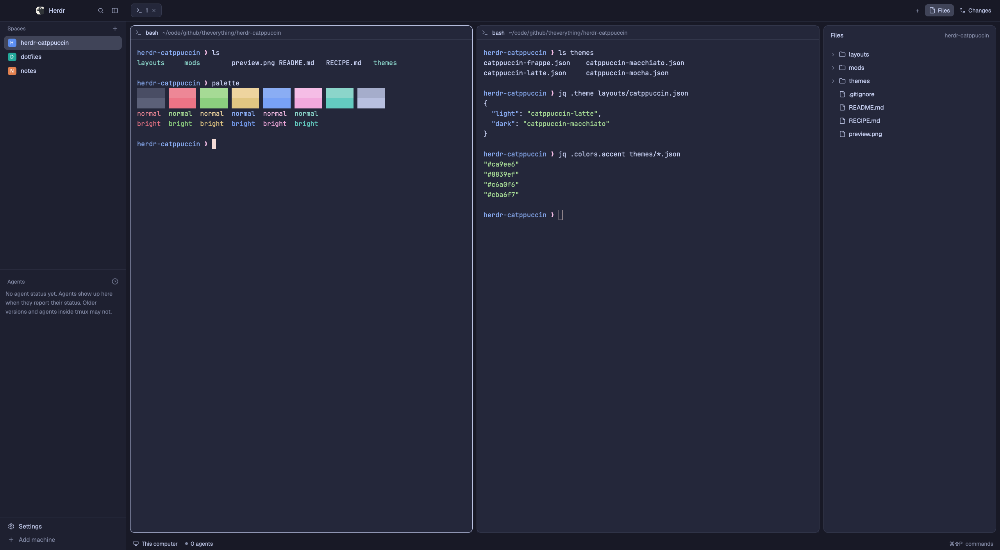

# Catppuccin

Herdr's default window in Catppuccin, in all four flavors, with the colors
placed the way the official Catppuccin Zed port places them. The title bar and
status bar are Crust, the sidebar is Mantle, and terminals are Base cards on a
Crust background. Accents are Mauve, and the terminals use each flavor's
official palette. The layout shows Latte in light mode and Macchiato in dark
mode; Frappé and Mocha are a theme-menu pick away.

## What you see

Colors are named by their Catppuccin role. Hex values are Macchiato's; the
other flavors are in the table at the end of this section.

Left to right, top to bottom:

- **Sidebar** (268 px, Mantle):
  - **Title row** (46 px, Crust): the Herdr logo, search and the sidebar
    toggle, with a 1 px Surface 0 line under it.
  - **Spaces and Agents lists**: Herdr's own `spaces` and `agents` mods.
  - **Footer** (69 px): Settings and Add machine, below a Surface 0 line.
- **Tab bar** (46 px, Crust): tabs are 29 px pills.
  - The active tab is Base with a Surface 0 border and Text. Inactive tabs are
    Crust with Subtext 1 text.
  - On the right: + (new terminal or agent), Files and Changes. The button of an
    open panel uses the `selected` color.
  - The Surface 0 line under the bar meets the one under the sidebar's title
    row.
- **Work area** (Crust, 8 px padding):
  - Each pane is a Base card with 10 px corners, a 1 px Surface 0 border and a
    30 px header (Herdr's `pane` mod).
  - The focused pane's border is Text.
  - Files and Changes open as a 368 px panel on the right.
- **Status bar** (28 px, Crust, Surface 0 line above): the machine, branch, agent
  count and the command palette hint, in Subtext 1 at 11.8 px.
- **Terminals**: Base background, Text foreground, Rosewater cursor, and the
  flavor's 16 ANSI colors from the Zed port:
  - Dark flavors: black is Surface 1 / Surface 2 and white is Subtext 0 /
    Subtext 1.
  - Latte reverses them: black is Subtext 1 / Subtext 0 and white is Surface 2 /
    Surface 1.
  - The bright colors are the style guide's more saturated variants (Macchiato:
    `#ec7486`, `#8ccf7f`, `#e1c682`, `#78a1f6`, `#f2a9dd`, `#63cbc0`).

Panel colors in each theme file:

| Role | Color |
|---|---|
| canvas | Crust |
| chrome, surface, popover | Mantle |
| raised, hover, border | Surface 0 |
| selected | Zed's selected-item color blended over Mantle |
| input | Surface 2 |
| foreground, solid | Text |
| muted | Subtext 1 |
| dim | Overlay 1 |
| accent | Mauve |
| accent_foreground, solid_foreground | Crust |
| selection (terminals) | Overlay 2 blended over Base: 25% for the dark flavors, 30% for Latte |

The resulting values:

| | Latte | Frappé | Macchiato | Mocha |
|---|---|---|---|---|
| Crust (canvas) | `#dce0e8` | `#232634` | `#181926` | `#11111b` |
| Mantle (chrome) | `#e6e9ef` | `#292c3c` | `#1e2030` | `#181825` |
| Base (terminals) | `#eff1f5` | `#303446` | `#24273a` | `#1e1e2e` |
| Surface 0 (border) | `#ccd0da` | `#414559` | `#363a4f` | `#313244` |
| Text | `#4c4f69` | `#c6d0f5` | `#cad3f5` | `#cdd6f4` |
| Subtext 1 (muted) | `#5c5f77` | `#b5bfe2` | `#b8c0e0` | `#bac2de` |
| Mauve (accent) | `#8839ef` | `#ca9ee6` | `#c6a0f6` | `#cba6f7` |
| selected | `#c3c7d2` | `#4a4e62` | `#404458` | `#3b3c4f` |
| selection | `#cccfd7` | `#494e63` | `#404459` | `#3b3d4f` |

## How it behaves

Everything works as in Herdr's default layout (`main`). Only the colors and the
tab bar's height differ.

- **Agent status** uses the status colors Herdr derives from the ANSI colors:
  - working: a spinning ring on its tab and in the Agents list.
  - blocked and done: a dot on the tab.
  - blocked agents also add "· N needs you" to the status bar.
  - done turns idle once someone has looked at it.
- **Tabs:**
  - Click to show a tab, double-click to rename it.
  - Drag a tab onto another to reorder.
  - Right-click for the tab menu.
  - Scroll over the bar to step through tabs.
  - The × on the active tab closes it.
- **Files and Changes** open and close the right panel. Each space remembers
  which panel it had open.
- **Hover:** buttons and inactive tabs turn Surface 0.
- **Window:** the sidebar toggle folds the sidebar to a rail. Drag the title row
  or the tab bar to move the window; double-click to maximize.
- **Flavor:**
  - The layout follows the system appearance (or the person's `appearance`
    setting): Latte when light, Macchiato when dark.
  - Picking Frappé or Mocha from the theme menu replaces the dark one; picking
    Latte replaces the light one.

## Built from

- **`layouts/catppuccin.json`**: a clone of Herdr's `main` layout (0.1.12).
  - The root sets
    `"theme": { "light": "catppuccin-latte", "dark": "catppuccin-macchiato" }`
    and `"preview": "layouts/catppuccin.svg"`.
  - Changes from `main`:
    - `brand` and `sidebar-footer` use `catppuccin-chrome`.
    - `tabs` uses `catppuccin-tabs` and is 46 px tall (was 42).
    - `status` uses `catppuccin-status`.
    - The pane `focus` color is `foreground` (was `accent`).
- **`layouts/catppuccin.svg`**: the picture Settings shows for the layout, drawn
  in Macchiato.
- **`themes/catppuccin-{latte,frappe,macchiato,mocha}.json`**: one per flavor,
  each with background, foreground, selection, cursor, the 16 ANSI colors and
  the panel colors. They're generated from the Zed port's `themes/catppuccin-mauve.json`:

  | Herdr field | Zed key |
  |---|---|
  | background, foreground | `terminal.background`, `terminal.foreground` |
  | cursor | `players[0].cursor` |
  | selection | `players[0].selection`, blended over `terminal.background` |
  | ansi | `terminal.ansi.*`, then `terminal.ansi.bright_*` |
  | canvas | `title_bar.background` (also `tab_bar` and `status_bar`) |
  | chrome | `panel.background` |
  | surface | `surface.background` |
  | popover | `elevated_surface.background` |
  | raised, hover | `element.hover` |
  | selected | `ghost_element.selected`, blended over `panel.background` |
  | border | `border` |
  | input | `text.placeholder` |
  | foreground, solid | `text` |
  | muted | `text.muted` |
  | dim | `icon.muted` |
  | accent | `text.accent` |
  | accent_foreground, solid_foreground | `vim.mode.text` |

- **`mods/catppuccin-tabs`**: Herdr's `tabs` mod. The bar, inactive tabs and the
  closed panel buttons use `t.canvas` instead of `t.chrome`. The active tab uses
  `t.background` instead of `t.raised`.
- **`mods/catppuccin-chrome`**: Herdr's `workspace-chrome` mod, with its icons.
  The title row uses `t.canvas` and gets a bottom border. The footer is
  unchanged.
- **`mods/catppuccin-status`**: Herdr's `workspace-status` mod with `t.canvas`.
- **Shipped mods used as they are:** `spaces`, `agents`, `pane`, `files`,
  `changes`, `menu`, `new-menu`, `picker`, `machine-add`. The tab bar uses icons
  from `mods/pane`, `mods/files` and `mods/changes`.
- **Commands the mods run:** `tab.select`, `tab.rename`, `tab.move`,
  `tab.close`, `tab.prev`, `tab.next`, `layout.show`, `layout.hide`,
  `layout.select`, `mod.open`, `app.settings`, `app.palette`, and the
  `window.*` commands.
- **Theme names only:** the three mods use only theme color names, never hex,
  so every flavor (and any other theme) works without changing them.

## Watch out

- **Copy the theme files too:** put all four `themes/catppuccin-*.json` in the
  home's `themes/` folder, not just the layout and mods. Without them the layout
  falls back to another theme.
- **The mods are clones:** they copy Herdr 0.1.12's `tabs`, `workspace-chrome`
  and `workspace-status`, so they won't get Herdr's later fixes. If they drift,
  clone the current mods again and repeat the few color swaps.
- **Translucent colors are pre-blended:** Herdr theme files take `#rrggbb` only,
  so Zed's translucent colors are worked out in advance. Selection is blended
  over Base, selected rows over Mantle. Latte's selection is 30% where the dark
  flavors use 25%, as in the Zed port.
- **Text on accent is Crust:** in Latte, Crust is light, so text on Mauve is
  light. Don't hard-code a dark color there.
- **The Crust bars come from the mods, not the theme:** Herdr has one `chrome`
  role for both sidebars and bars, so the cloned mods draw the bars with
  `canvas`.
- **Not matched from Zed:**
  - Zed's inactive tabs are a shade darker than Crust. Herdr has no color role
    for it, and a hex value would break other flavors.
  - Zed's title bar spans the full width; here the sidebar divider crosses it.
- **Keep the heights equal:** the tab bar must stay as tall as the sidebar's
  title row (46 px), or the lines under them won't meet.
- **macOS window buttons:** the title row leaves 76 px for them
  (`traffic_lights: [12, 16]`).
- **Agent status colors aren't set:** Herdr derives them from the ANSI colors.

## Done when

- `herdr-app check` passes for each of the three mods.
- After `herdr-app do layout.switch --name catppuccin`, sampling a
  `herdr-app shot` gives these colors, for each flavor:

  | | sidebar | title row, tab bar, status bar, gaps | terminals, active tab |
  |---|---|---|---|
  | Macchiato (dark appearance) | `#1e2030` | `#181926` | `#24273a` |
  | Latte (light appearance) | `#e6e9ef` | `#dce0e8` | `#eff1f5` |
  | Frappé (`app.theme`) | `#292c3c` | `#232634` | `#303446` |
  | Mocha (`app.theme`) | `#181825` | `#11111b` | `#1e1e2e` |

- The lines under the title row and the tab bar are at the same height.
- Inactive tabs blend into the bar.
- Clicking a terminal gives its card a Text-colored border, and the other cards
  stay Surface 0.
- In Macchiato, `printf '\e[31mred \e[91mbright\e[0m\n'` shows `#ed8796` and
  then `#ec7486`.
